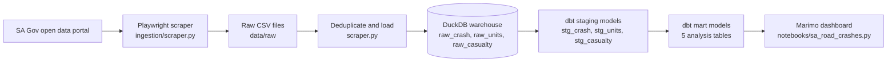
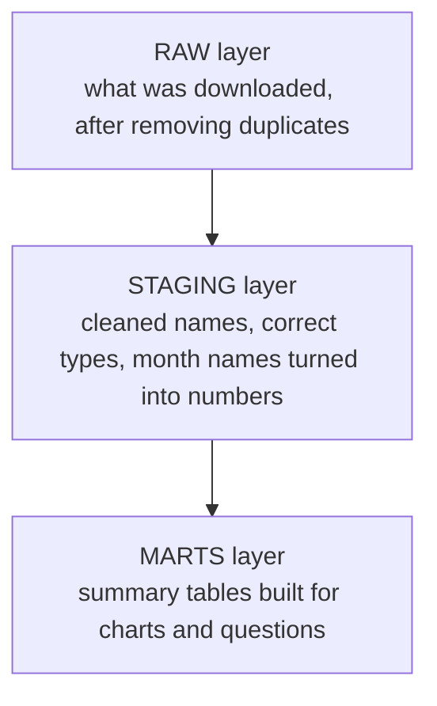
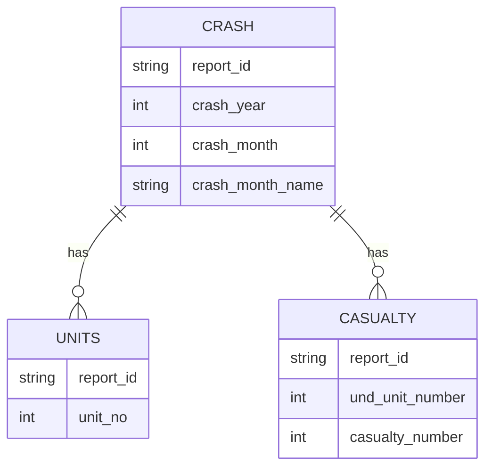
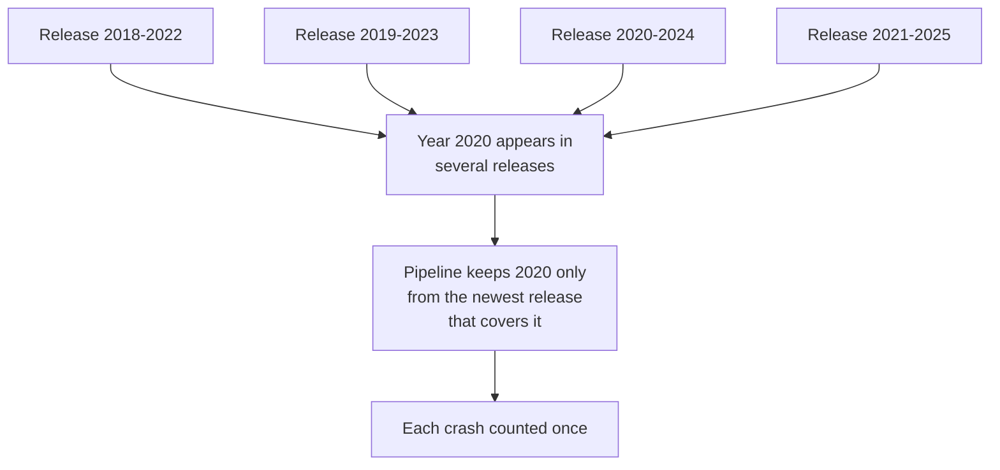

# SafeRoads SA


An end-to-end data project that collects South Australian road crash data, cleans it, models it, and shows it in an interactive dashboard.


Data covers crashes from 2012 to 2025, from the South Australian Government open data portal (Road Crash Data).


---


## What this project does, in plain words


Think of it as a small factory:


1. **Collect**: a robot browser (Playwright) visits the government data site and downloads the crash files.
2. **Clean and store**: a Python script removes duplicates and loads everything into a single database file (DuckDB).
3. **Model**: dbt turns the raw tables into tidy, tested tables that are easy to analyse.
4. **Show**: a Marimo notebook reads those tables and draws charts.


---


## How the data flows





## The three layers of the database





Analogy: raw is the groceries, staging is the washed and chopped ingredients, marts are the finished meals.


## How the three tables relate





- A **crash** is one incident.
- A **unit** is one vehicle or road user in that crash (about 2.13 per crash on average).
- A **casualty** is one injured or killed person (a casualty is linked to the unit the person was in).


## Why overlapping releases need care


The portal publishes both single-year files (for example `2019_DATA_SA_Crash.csv`) and multi-year files (for example `2021-2025_DATA_SA_Crash.csv`). The same crash can appear in more than one file.





Without this rule, crashes were counted about 74% too many times (356,672 instead of the correct 204,860).


---


## The mart tables


| Mart | What each row is | Question it answers |
|---|---|---|
| `mart_crash_severity_trends` | One year and severity level | Are crashes getting more or less severe over time? |
| `mart_high_risk_locations` | One suburb or council area | Where do the most crashes and fatalities happen? |
| `mart_conditions_analysis` | One combination of road surface, weather, moisture and lighting | Which conditions are most dangerous? |
| `mart_casualty_demographics` | One age group, sex and casualty type | Which groups are most at risk? |
| `mart_vehicle_analysis` | One vehicle type and age group | Which vehicles are most often involved? |


---


## Project structure


```
saferoads-sa/
├── ingestion/
│   └── scraper.py
├── dbt_project/
│   ├── dbt_project.yml
│   ├── profiles.yml.example
│   ├── models/
│   │   ├── staging/
│   │   └── marts/
│   └── tests/
├── notebooks/
│   └── sa_road_crashes.py
├── data/
│   └── raw/
├── warehouse/
│   └── saferoads.duckdb
├── logs/
├── requirements.txt
└── README.md
```


`data/`, `warehouse/` and `logs/` are created when you run the pipeline and are not stored in git.


---


## What you need before starting


- Python 3.11 or newer
- Git
- About 300 MB of free disk space for the download
- An internet connection


## Setup


**Linux and macOS**


```bash
git clone https://github.com/shresthayujan/saferoads-sa.git
cd saferoads-sa
python3 -m venv .venv
source .venv/bin/activate
pip install -r requirements.txt
playwright install firefox
```


On Linux, if the browser reports missing system libraries, run `playwright install --with-deps firefox` instead.


**Windows (PowerShell)**


```powershell
git clone https://github.com/shresthayujan/saferoads-sa.git
cd saferoads-sa
python -m venv .venv
.venv\Scripts\Activate.ps1
pip install -r requirements.txt
playwright install firefox
```


If PowerShell refuses to activate the environment, run this once and try again:


```powershell
Set-ExecutionPolicy -Scope CurrentUser RemoteSigned
```


## Run the pipeline


**1. Collect and load the data**


```bash
python ingestion/scraper.py
```


You should see log lines for each stage, ending with row counts of 204,860 crashes, 437,279 units and 81,883 casualties, and the message "Warehouse saved to: ...".


**2. Set up the dbt connection**


Copy the example profile to dbt's default location, which keeps it outside the repo:


```bash
mkdir -p ~/.dbt
cp dbt_project/profiles.yml.example ~/.dbt/profiles.yml
```


On Windows PowerShell:


```powershell
New-Item -ItemType Directory -Force "$HOME\.dbt"
Copy-Item dbt_project\profiles.yml.example "$HOME\.dbt\profiles.yml"
```


The example points at `../warehouse/saferoads.duckdb`, so always run dbt from inside the `dbt_project` folder.


**3. Build and test the models**


```bash
cd dbt_project
dbt build
```


You should see all 8 models succeed and the tests finish with 0 errors and 1 warning (see "Known data notes").


**4. Open the dashboard**


```bash
cd ..
marimo run notebooks/sa_road_crashes.py
```


On Windows PowerShell use `marimo run notebooks\sa_road_crashes.py`. Use `marimo edit` instead of `marimo run` if you want to change the notebook.


---


## How duplicates are handled


For each year, the pipeline uses only the newest release that covers it. Then:


- **Crashes** are unique by report ID.
- **Units** are unique by report ID plus unit number.
- **Casualties** are unique by report ID, unit number and casualty number.


## What the tests check


| Test | Why it exists |
|---|---|
| No crash appears in more than one release | Overlapping releases once inflated crashes by about 74% |
| Unit key is unique | A wrong key once collapsed units to about one per crash |
| Casualty key is unique | A too-coarse key once dropped real casualties |
| Row counts match between raw and staging | Catches rows lost or duplicated inside dbt |
| Units per crash between 1.5 and 3.0 | Catches over-deduplication (currently about 2.13) |


---


## Known data notes


- **2020 is the lowest year** at 11,534 crashes, against roughly 11,500 to 14,000 in other years. This likely reflects COVID-19 travel restrictions rather than a data fault.
- **5 units have no unit type**, which causes the single dbt warning. This is expected.
- **Month names** such as "August" are converted to numbers in `crash_month`, and the original text is kept in `crash_month_name`.


## Troubleshooting


| Problem | What to do |
|---|---|
| dbt cannot find a profile | Complete step 2 above and run dbt from `dbt_project` |
| Database is locked | Close the dashboard before re-running the pipeline or dbt (mostly affects Windows) |
| Browser or system library errors on Linux | Run `playwright install --with-deps firefox` |
| PowerShell will not activate the venv | Run the ExecutionPolicy command shown in Setup |
| Strange characters in the console on Windows | Use Windows Terminal, or run `chcp 65001` first |


## Tech stack


| Tool | Role |
|---|---|
| Python | Pipeline language |
| Playwright (Firefox) | Downloads the data like a real browser |
| DuckDB | Single-file analytical database |
| dbt | Cleans, models and tests the data |
| Marimo | Interactive dashboard notebook |
| Altair | Charts |


## Data source and licence


Data: [Road Crash Data](https://data.sa.gov.au/data/dataset/road-crash-data), Government of South Australia, licensed under [Creative Commons Attribution 4.0](http://creativecommons.org/licenses/by/4.0).


## Author


Yujan Shrestha
