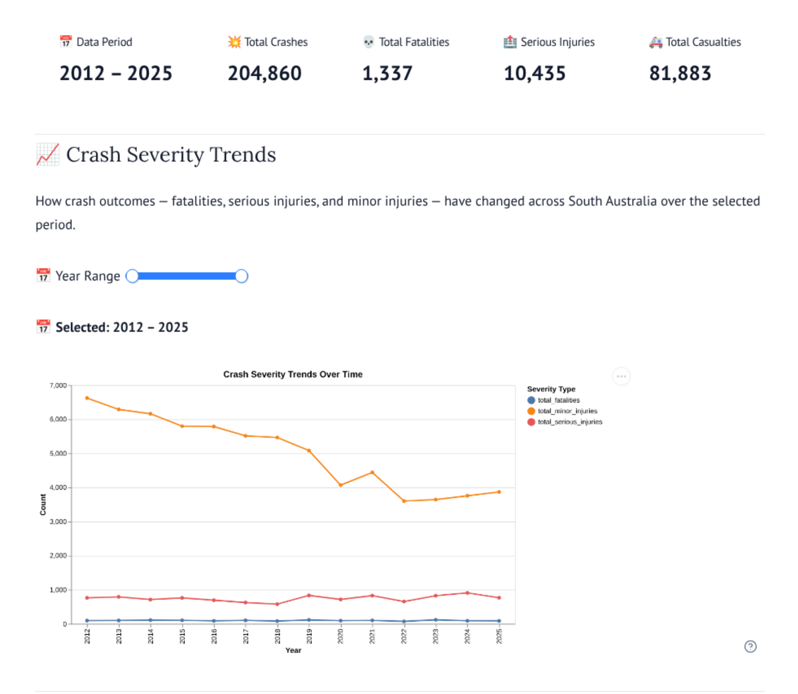
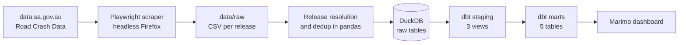
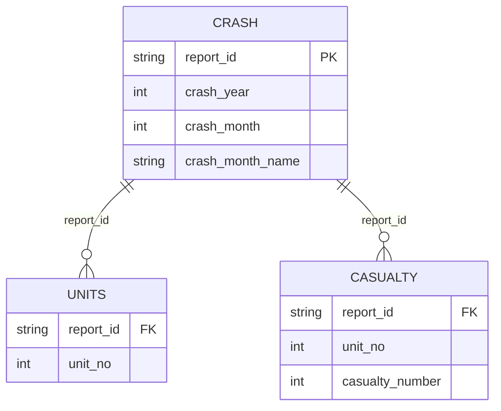

# SafeRoads SA


An ELT pipeline and analytics layer for South Australian road crash data (2012 to 2025). It scrapes the open data portal, resolves overlapping releases, loads into DuckDB, models with dbt, and serves a Marimo dashboard.





**Stack:** Python, Playwright, DuckDB, dbt-duckdb, Marimo, Altair


**Scale:** 204,860 crashes, 437,279 units, 81,883 casualties


---


## Architecture





| Layer | Responsibility | Materialisation |
|---|---|---|
| raw | Deduplicated source data, loaded as delivered | Tables, written by Python |
| staging | Type casting, renaming, month parsing | Views |
| marts | Aggregates for analysis | Tables |


## Data model





Grain: one row per crash, one per unit (vehicle or road user) within a crash, and one per casualty within a unit.


### Marts


| Model | Grain | Purpose |
|---|---|---|
| `mart_crash_severity_trends` | year, severity | Severity trend over time |
| `mart_high_risk_locations` | suburb, LGA | Crash and fatality concentration |
| `mart_conditions_analysis` | surface, weather, moisture, lighting | Outcomes by environmental conditions |
| `mart_casualty_demographics` | age group, sex, casualty type | At-risk groups |
| `mart_vehicle_analysis` | vehicle type, age group | Vehicle involvement |


---


## Engineering notes


### Overlapping releases


The portal publishes single-year files and rolling multi-year files (for example `2018-2022` through `2021-2025`), so the same crash appears in several releases. Naive concatenation produced 356,672 crashes against 204,860 after correction, an inflation of roughly 74%. The pipeline assigns each year to the newest release that covers it, then deduplicates on natural keys:


| Table | Unique key |
|---|---|
| Crash | `report_id` |
| Units | `report_id`, `unit_no` |
| Casualty | `report_id`, `unit_no`, `casualty_number` |


Earlier key choices were wrong in both directions (units collapsed to about one per crash, casualties dropped), which is why the tests below exist.


### Month parsing


The source stores month as text (for example "August"). `stg_crash` converts it to an integer with `try_strptime` for full and abbreviated names, falling back to `try_cast`, and keeps the original in `crash_month_name`. All 204,860 rows resolve to non-null values.


### Path handling


Paths in `scraper.py` and the notebook are anchored to the project root, so scripts run correctly from any working directory.


---


## Data quality


dbt runs 52 passing checks plus 1 warning on a full build (53 total, including models). The singular tests encode lessons from development:


| Test | Guards against |
|---|---|
| `assert_no_crash_in_multiple_releases` | Cross-release duplication |
| `assert_stg_units_unique_key` | Wrong unit grain |
| `assert_stg_casualty_unique_key` | Wrong casualty grain |
| `assert_crash_count_reconciles` | Row loss or fan-out between raw and staging (also units and casualty variants) |
| `assert_units_per_crash_in_range` | Over-deduplication (observed ratio 2.13, bounds 1.5 to 3.0) |


The reconciliation tests detect problems introduced in dbt. Scraper-level errors are guarded by the unique-key tests and the units-per-crash ratio.


---


## Running it
`Requires Python 3.10 to 3.13 (dbt-core 1.11 does not support Python 3.14).`

```bash
git clone https://github.com/shresthayujan/saferoads-sa.git
cd saferoads-sa
python3 -m venv .venv && source .venv/bin/activate
pip install -r requirements.txt
playwright install firefox


python ingestion/scraper.py


mkdir -p ~/.dbt
cp dbt_project/profiles.yml.example ~/.dbt/profiles.yml
cd dbt_project && dbt build && cd ..


marimo run notebooks/sa_road_crashes.py
```


Windows (PowerShell): activate with `.venv\Scripts\Activate.ps1` and copy the profile to `$HOME\.dbt\profiles.yml`. Close the dashboard before re-running the pipeline, as DuckDB locks the file.


The example profile uses the relative path `../warehouse/saferoads.duckdb`, so run dbt from `dbt_project/`.


---


## Known limitations


- 2020 has the lowest crash count (11,534), plausibly due to COVID-19 restrictions. This is an interpretation, not something the data states.
- 5 units have no unit type, producing the single dbt warning (`not_null_stg_units_unit_type`).
- The scraper depends on the portal's page structure and will need maintenance if the site changes.
- No orchestration or CI yet.


## Repository layout


```
ingestion/        scraper.py: scrape, deduplicate, load to DuckDB
dbt_project/      models/staging, models/marts, tests, profiles.yml.example
notebooks/        sa_road_crashes.py (Marimo)
docs/             dashboard screenshot
data/raw/         downloaded CSVs (gitignored)
warehouse/        saferoads.duckdb (gitignored)
```


## Data source


[Road Crash Data](https://data.sa.gov.au/data/dataset/road-crash-data), Government of South Australia, licensed under [CC BY 4.0](http://creativecommons.org/licenses/by/4.0).


## Author


Yujan Shrestha
Data Engineer
